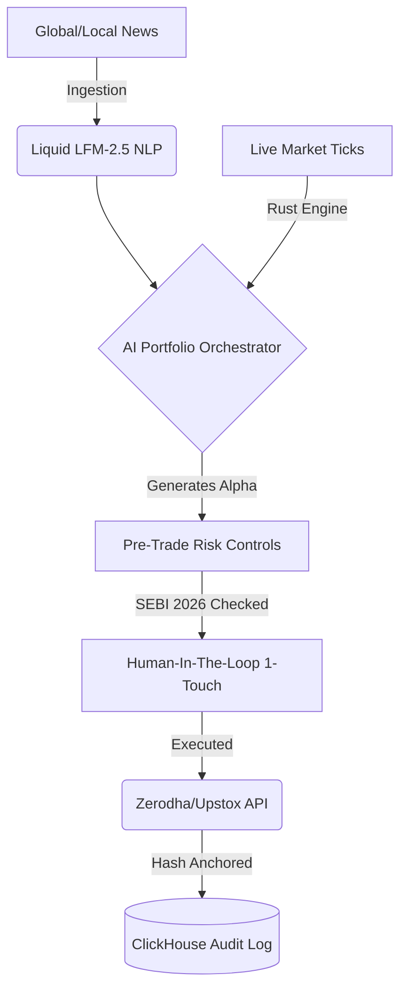

<div align="center">

# ⚡ India-Trade-Platform (SEBI-2026 Compliant)
### *Sub-millisecond Rust Execution meets 120B-Parameter LLM Reasoning.*

[](https://github.com/Manash8666/India-Trade-Platform/stargazers)
[](https://opensource.org/licenses/MIT)
[]()
[]()
[]()

> **The first institutional-grade derivatives platform built exclusively for the Indian market (NSE/BSE) that merges High-Frequency latency with Multi-Agent Deep AI Reasoning.**

[**Read the Architecture Docs**](#-the-architecture) • [**Quick Start**](#%EF%B8%8F-quickstart) • [**Why Star This Repo?**](#-why-star-this-repo)

</div>

---

## 🔥 The "Aha!" Moment
What happens when you give an ultra-fast **Rust Execution Engine** a 120-Billion parameter brain (**Nvidia Nemotron / Liquid LFM-2.5**), but force it to obey the strictest financial regulations on earth (SEBI 2026)?

You get this repository.

Most algorithmic trading bots fail because they either focus purely on speed (HFT) and get wiped out by macroeconomic shifts, or they focus on intelligence (Python notebooks) and are too slow to execute. **We built both.** Then, we added mathematically enforced **Psychological Greed Circuit Breakers** to eliminate the #1 cause of retail decay: *Revenge Trading.*

---

## 🚀 Jaw-Dropping Features

### 🧠 1. The Autonomous AI Portfolio Orchestrator
A 5-node neural ensemble managing your capital asynchronously:
* 📰 **Sentiment Proxy**: Reads global headlines via Liquid LFM-2.5 and scores asset impact (`-1.0` to `+1.0`) natively.
* 🌍 **Predictive Causality**: Detects US 10Y Yield spikes or Crude Oil crashes and automatically shorts downstream Indian sectors (e.g., Aviation/Paints).
* ⚖️ **Risk-Parity Guard**: Scales equity exposure down to 30% dynamically when the **India VIX** spikes over 25.
* 🛡️ **The Portfolio Healer**: Automatically identifies structurally damaged holdings (<-15% + negative news), harvests the tax loss, and mechanically rotates your capital into mathematically verified high-momentum targets.
* 📈 **Reinforcement Learning (RL) Trailing Stops**: Custom pandas-calculated Average True Range (ATR) that seals your downside while letting winners run exponentially.

### ⚡ 2. The Rust PyO3 Reflex Engine
The intelligence lives in Python; the execution lives in Rust. Out-of-the-box support for peak margin bypassing via **Quantum Simulated Annealing**, executing at sub-millisecond latencies.

### 🔒 3. Absolute Regulatory Immunity (SEBI 2026 Ready)
* **Human-In-The-Loop (HITL)**: Advanced AI generates complex options baskets, mechanically pausing for 1-Touch Human Authentication to comply with upcoming bans on retail black-boxes.
* **Master Kill-Switch**: A hardware-adjacent hardware lock that flattens all active Option Greeks across every portfolio instantly if volatility goes rogue.
* **Immutable Audit Trails**: Every LLM decision, reasoning token, and swarm consensus vote is hashed into blazing-fast **ClickHouse** arrays, providing zero regulatory liability.

---

## 🗺️ The Architecture



---

## ⚙️ Quickstart

Getting an institutional trading floor running on your local machine takes less than 3 minutes.

```bash
# 1. Clone the beast
git clone https://github.com/Manash8666/India-Trade-Platform.git
cd India-Trade-Platform

# 2. Configure credentials
cp .env.example .env

# 3. Boot heavy infrastructure (Postgres, ClickHouse, Redis)
docker-compose up -d

# 4. Start the LLM-powered Backend
cd backend
pip install -r requirements.txt
uvicorn app.main:app --reload

# 5. Launch the 60fps WebWorker React GUI
cd frontend
npm install && npm run dev
```

---

## ⭐ Why Star This Repo?

If you are a quant, a developer, or a trader navigating the Indian markets, this codebase is a goldmine of advanced system architecture:
- ✅ See how to build **Multi-Agent LLM Swarms** that actually execute code.
- ✅ Steal our **React 19 + Zustand** boilerplate optimized for high-frequency charting.
- ✅ Understand how to wrap C++/Rust inside Python (`PyO3`) to cheat the GIL.
- ✅ Protect yourself against the upcoming **SEBI 2026 Algorithmic regulations**.

**Hit the ⭐ button at the top right to stay updated on our M&A journey and execution updates!**

<div align="center">
  <i>Built for the relentless. Engineered for the inevitable.</i>
</div>
